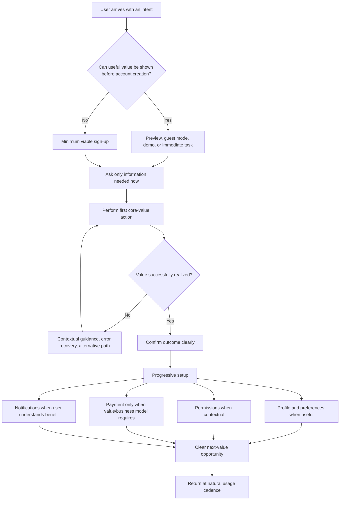
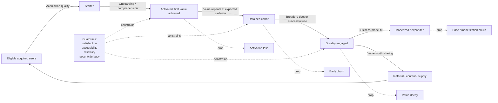

# What Makes an App Exceptional: A Research-Based Evaluation Framework for AI-Assisted Product Reviews

## Executive summary

An exceptional app is not simply polished, feature-rich, fast-growing, or visually attractive. The strongest evidence across product practice, HCI research, large-scale experimentation, accessibility standards, reliability engineering, and the histories of highly adopted products points to a more demanding definition:

> **An exceptional app repeatedly delivers an important user outcome with unusually little friction, earns enough trust to become habitual or preferred, remains dependable as usage grows, and has an economic and technical system capable of sustaining that value.**

A useful mental model is:

**Exceptional app ≈ Valuable × Usable × Trustworthy × Reliable × Learnable/Adaptable**

This is a synthesis, not a validated mathematical formula. Its deliberately multiplicative form captures an important practical reality: strengths do not always compensate for catastrophic weaknesses. Brilliant UX does not rescue a product nobody needs. Rapid growth does not neutralize severe security or legal failures. Beautiful onboarding does not compensate for poor retention. A compelling core product can still be crippled by unreliable infrastructure.

Product discovery practice reinforces the first principle: before optimizing delivery, teams must establish that what they are building is useful and usable, while Customer Development emphasizes testing business and customer hypotheses outside the building rather than treating internal plans as facts. Jobs-to-be-Done and the Value Proposition Canvas similarly move evaluation away from feature inventories and toward the circumstances, jobs, pains, and gains that actually cause customers to choose products. citeturn19search6turn20search13turn20search8turn19search3

Exceptional apps therefore tend to satisfy five tests simultaneously:

| Test | Core question | Strong evidence |
|---|---|---|
| **Desirability** | Does an important, identifiable user genuinely want this? | Interviews, observed behavior, prototype tests, willingness to switch/pay, organic demand |
| **Value realization** | Does the user actually obtain the promised outcome? | Activation around a value event, task success, time-to-value, repeat core-job completion |
| **Durability** | Do users come back at the natural cadence of the problem? | Cohort retention, renewal, repeat transactions, resurrection, expansion |
| **Trust and quality** | Can users depend on the product without unacceptable risk or exclusion? | Accessibility conformance, security controls, privacy minimization, SLO attainment, low core-task failure |
| **Sustainability** | Can the organization keep delivering and improving the value? | Healthy unit economics, scalable architecture, reliable releases, localization capability, compliance, learning velocity |

The distinction between **usage and value** is crucial. Google’s HEART research was developed precisely because generic operational measures such as page views, uptime, latency, active users, and earnings do not by themselves capture user experience; HEART instead organizes measurement around Happiness, Engagement, Adoption, Retention, and Task Success. A complementary North Star approach asks teams to choose a metric that represents delivered customer value, can be influenced by product work, and predicts sustainable business results. citeturn19search0turn20search6

Accordingly, metrics such as downloads, registrations, DAU, session length, notifications opened, or total time spent should **never be treated as inherently positive**. Their meaning depends on the product. A tax-preparation app, travel-booking product, password manager, messaging product, and entertainment feed have radically different natural frequencies. Even in recommendation systems, Google research has cautioned that behavioral engagement measures do not always align with self-reported satisfaction and that short-term experiment outcomes may not predict long-term effects. citeturn11search14turn11search18

The evaluation unit should instead be the **user-value event**: the observable event indicating that the user completed the job for which the app was chosen. Examples might be a successful payment, delivered ride, message exchange, completed meeting, booked stay, useful document created, recovered credential, finished lesson, or accurately completed workflow. Activation should mean reaching meaningful value, not merely finishing registration.

Good UX substantially changes whether users reach that event. Nielsen’s long-lived usability heuristics emphasize system-status visibility, correspondence with users’ language and expectations, user control, consistency, error prevention, recognition rather than recall, efficiency, minimalism, recovery, and contextual help. Modern platform guidance adds a particularly important onboarding principle: let users experience the product before forcing nonessential setup, permissions, tutorials, ratings, or purchasing decisions. citeturn19search1turn12search1turn12search4

Quality is similarly broader than “no crashes.” Android’s current quality framework explicitly separates core value, user experience, technical quality, and privacy/security, while Google SRE recommends defining reliability through user-relevant service-level indicators and objectives rather than pursuing abstract 100% availability. Error budgets create an explicit mechanism for balancing innovation against reliability. citeturn15search2turn21search5turn21search1

Security, privacy, accessibility, and compliance should be **gates, not optional scoring bonuses**. OWASP MASVS organizes mobile-security verification around storage, cryptography, authentication, networking, platform interaction, code quality, resilience, and privacy. WCAG 2.2 provides testable accessibility success criteria and is the version W3C recommends for maximizing future applicability. Privacy obligations are increasingly concrete: GDPR includes purpose limitation, data minimization, storage limitation and security principles; California's CCPA/CPRA currently provides rights including access/knowledge, deletion, correction, opting out of sale/sharing, and limits on sensitive-data use; and COPPA imposes additional obligations on covered child-directed services. citeturn21search2turn21search0turn22search0turn22search1turn22search6

Growth is most durable when it is an extension of product value rather than a layer of promotional tricks. Slack’s self-service freemium adoption, Zoom’s participant-to-host funnel, Facebook’s historical social-distribution loops, Uber’s marketplace network, Airbnb’s host/guest trust system, and TikTok’s interest-driven recommendation feed all illustrate mechanisms in which using the product can naturally improve distribution, supply, personalization, or network value. citeturn17search0turn17search5turn16search9turn17search6turn17search7turn18search2

The final governing principle is **evidence over intuition**. Microsoft’s large-scale online experimentation work emphasizes that randomized experiments, correctly designed, provide causal evidence and has repeatedly described results as humbling for teams relying on prior intuition. But experimentation itself needs trustworthy statistics, guardrails, and long-term interpretation; otherwise an organization merely becomes efficient at optimizing the wrong metric. citeturn20search3turn11search18

For Claude Code, the recommended review stance is therefore:

**Do not ask, “Does this app have the expected features?” Ask, “For a clearly defined user and context, what evidence shows that this product creates important value, minimizes the cost of receiving that value, earns repeat use and trust, survives real-world failure modes, and can sustain improvement?”**

A review should always separate **observed evidence, inference, hypothesis, and missing information**. An attractive interface is not evidence of retention. Code quality is not proof of product-market fit. Downloads are not proof of value. A growth loop is not proven because a share button exists. A pricing page does not prove willingness to pay. Claude should explicitly refuse to infer unavailable business or behavioral metrics from screenshots or source code alone.

## Evaluation model and evidence hierarchy

A good AI reviewer needs multiple frameworks because no single framework covers the whole product. HEART is strong for UX measurement but does not establish market desirability. Jobs-to-be-Done helps explain demand but does not assess production reliability. DORA evaluates software delivery but not whether the software should exist. OWASP can establish security discipline without proving the product is delightful.

The frameworks are best treated as complementary lenses.

| Framework | What it evaluates best | Key question | Primary blind spot | Recommended use |
|---|---|---|---|---|
| **Jobs-to-be-Done** | Demand and choice | “What progress is the customer hiring this product to make, in what circumstance?” | Does not itself establish UX, reliability, or economics | Idea framing, interviews, positioning, competitor analysis. Christensen et al. emphasize functional, social, emotional, and contextual dimensions of a job. citeturn20search8 |
| **Value Proposition Canvas** | Customer-value fit | “Which jobs, pains, and gains does the proposition address?” | A canvas can encode untested assumptions | Convert every claim into customer evidence and experiments. citeturn19search3 |
| **Customer Development / Product Discovery** | Risk reduction before scaling | “What must be true, and what evidence would prove or disprove it?” | Can become endless discovery without decision criteria | Validate desirability/usefulness/usability and business hypotheses before expensive scaling. citeturn20search13turn19search6 |
| **HEART** | User-centered measurement | “Are users happy, engaged, adopting, retaining, and succeeding at tasks?” | Categories still require product-specific goals and signals | UX scorecards and experiment guardrails. citeturn19search0 |
| **North Star Framework** | Value-centered organizational alignment | “What measurable delivered value predicts sustainable success?” | A badly chosen North Star creates coordinated misoptimization | Pair one value outcome with several controllable input metrics and guardrails. citeturn20search6 |
| **Nielsen heuristics** | Interaction usability | “Does the interface support users’ mental models and prevent/recover from errors?” | Heuristic review cannot replace observing users | Expert UI review before and alongside usability testing. citeturn19search1 |
| **Controlled experimentation** | Causal product decisions | “Did the change cause the outcome?” | Cannot tell you whether the tested objective is ethically or strategically correct | Mature products with sufficient traffic; pair primary metrics with guardrails and long-term checks. citeturn20search3turn11search18 |
| **SRE / error budgets** | Production dependability | “What reliability do users actually need, and how much failure can be tolerated?” | Says little about desirability | Define SLIs/SLOs for core journeys and use error-budget burn to govern release risk. citeturn21search5turn21search1 |
| **DORA metrics** | Engineering delivery capability | “Can the team ship quickly without creating instability?” | Delivery performance is not product value | Track change lead time, deployment frequency, failed-deployment recovery time, change-fail rate, and deployment-rework rate at service/application level. citeturn21search3 |

**Evidence should outrank scores.** For AI evaluation, the following evidence ladder is useful as a review convention:

| Evidence grade | Meaning | Example |
|---|---|---|
| **E0 — assertion** | Team belief with no external validation | “Busy parents will want this.” |
| **E1 — qualitative evidence** | Repeated user observations/interviews establish a problem or motivation | Users independently describe the same painful workaround |
| **E2 — behavioral evidence** | Users demonstrate behavior in prototypes/betas | High task completion; users return without prompting |
| **E3 — causal/live evidence** | Production cohorts or controlled experiments establish effects | Treatment improves activation while quality guardrails remain neutral |
| **E4 — durable evidence** | Effect persists across cohorts, segments, time, scale, and economic conditions | Strong retention/renewal plus healthy unit economics and operational quality |

This ladder is a proposed synthesis, not an industry standard. It prevents Claude from awarding the same confidence to a founder’s hypothesis and a year of retained production cohorts.

For **ideas**, Claude should primarily evaluate the quality of the hypothesis, market structure, evidence already collected, testability, and fastest path to de-risking. For **existing products**, it should demand telemetry, cohorts, task data, incident/security history, actual user research, and business outcomes. Customer Development’s central premise—that hypotheses require external validation—makes this distinction especially important. citeturn20search13

A simple dimension score can supplement the evidence grade:

| Score | Interpretation |
|---|---|
| **0** | Missing, actively harmful, or fundamentally broken |
| **1** | Major unresolved risks; largely assertion |
| **2** | Plausible but incomplete; weak or inconsistent evidence |
| **3** | Competent baseline; important requirements satisfied |
| **4** | Strong and instrumented; evidence shows above-baseline performance |
| **5** | Exceptional: differentiated, validated, resilient, and improving |

Do **not** average scores before applying gating criteria. A 5 in virality cannot mathematically cancel a 0 in security for a banking app. A health app with inaccessible critical controls should not receive a high overall assessment because its design system is excellent.

The most useful metrics also form a hierarchy:

| Measurement layer | Recommended measures | What it tells Claude | Misuse to avoid |
|---|---|---|---|
| **Value** | Core-job success; time-to-value; successful outcomes/user; value-centered North Star | Whether users receive the intended benefit | Using logins or screen views as proxies for value without validation. citeturn20search6 |
| **Activation** | `% eligible new users reaching first-value event`; median time/steps to value | Whether users cross the initial value threshold | Defining account creation as activation |
| **Retention** | Cohort N-period retention; rolling retention; renewal; repeat purchase/task; resurrection | Whether value endures | Applying D1/D7/D30 mechanically to products with different natural cadences. HEART treats retention separately from raw engagement. citeturn19search0 |
| **Engagement** | Meaningful action frequency, breadth, depth; active days at natural cadence | Depth of realized value | Assuming more time or more sessions is always better; engagement can diverge from satisfaction. citeturn11search14 |
| **UX** | Task success, error rate, time-on-task, abandonment, satisfaction/HEART measures | Ease and quality of receiving value | Optimizing visual preferences without task outcomes. citeturn19search0turn19search1 |
| **Growth** | Activated acquisition; organic/direct share; invite→activation conversion; loop cycle time; CAC by source | Whether distribution compounds economically | Reporting installs without activation/retention |
| **Economics** | Paid conversion, ARPU/ARPPU, MRR/ARR where relevant, gross margin, churn, NRR, contribution margin, payback | Sustainability | Treating revenue growth as proof of customer value |
| **Quality** | p50/p95/p99 latency, crash/ANR rates, core-task failure, SLO attainment, error-budget burn | User-perceived dependability | Reporting average latency while the tail is unusable. SRE explicitly uses percentile latency and availability SLIs. citeturn21search5 |
| **Delivery** | DORA five metrics | Ability to ship safely and repeatedly | Comparing unrelated teams without context; DORA explicitly stresses application/service context. citeturn21search3 |
| **Trust** | Security findings by severity/SLA, privacy request success, accessibility conformance, permission rejection, account compromise, policy incidents | Whether growth rests on defensible trust | “Zero reported incidents” as proof of security |

There is therefore **no universal “good” DAU/MAU, D7 retention, session length, conversion rate, or A/B-test lift**. Claude should compare an app against its product cadence, historical cohorts, target segment, alternatives, economics, and risk level rather than hallucinating generic benchmarks.

A reusable global prompt for Claude is:

```text
Act as a skeptical senior product leader, HCI researcher, UX reviewer,
growth analyst, security/privacy reviewer, and staff engineer.

Evaluate the app/idea for a clearly stated target user, job, context,
business model, and platform.

For every conclusion:
- distinguish OBSERVED EVIDENCE, INFERENCE, HYPOTHESIS, and UNKNOWN;
- never infer retention, revenue, product-market fit, security, or user
  satisfaction from UI/source code alone;
- identify the user-value event and natural usage cadence;
- score each applicable dimension 0–5 and assign evidence grade E0–E4;
- identify noncompensatory blockers before computing any aggregate score;
- prefer outcome metrics to activity/vanity metrics;
- identify metric gaming risks and counter-metrics;
- recommend the smallest experiment or investigation that would reduce
  the largest uncertainty;
- state where the evidence is insufficient rather than inventing benchmarks.

End with:
1. strongest reasons the app could win;
2. strongest reasons it could fail;
3. critical unknowns;
4. top three tests or fixes;
5. Go / Conditional Go / Iterate / No-Go judgment with confidence.
```

## Dimension-by-dimension reference matrix

The following matrices are the core reference for Claude Code. Metrics are suggested measures, not universal targets.

**Strategy, research, growth, and economics**

| Dimension | Definition and success criteria | Measurable metrics | Common pitfalls | Best practices | Example Claude evaluation prompt |
|---|---|---|---|---|---|
| **Product strategy** | A coherent choice of **which users/problems to serve, why this product can win, and what not to do**. Success means a focused wedge connected to durable advantage and explicit tradeoffs rather than a roadmap of unrelated features. Product discovery should test usefulness/usability before large engineering commitments. citeturn19search6turn20search13 | Strategic outcomes; adoption/retention in target segment; share of roadmap linked to strategic bets; win/loss reasons; strategic hypothesis validation | “Everyone” as target; feature parity as strategy; copying competitors; roadmap = strategy; too many simultaneous bets | Define target segment/job, alternatives, differentiated mechanism, non-goals, assumptions and evidence; revisit strategy when evidence changes | “Identify the target user, strategic wedge, alternative solutions, defensible advantage, non-goals and top assumptions. Which roadmap items do not support the strategy? Score coherence and evidence.” |
| **Value proposition** | The concrete reason a target customer should choose the app instead of alternatives. Strong propositions connect features to high-priority jobs, pains and gains, including social/emotional context where relevant. citeturn20search8turn19search3 | Message comprehension; problem severity; value-event completion; switching/willingness-to-pay; conversion after proposition exposure | Feature lists; generic claims such as “AI-powered”; solving low-priority pains; confusing buyer with user | Express value as “for X in circumstance Y, accomplish Z better than alternative A because mechanism B”; test language with actual customers | “Map the app to customer jobs, pains and gains. For every major feature, identify the user outcome it enables. Flag features with no validated customer priority.” |
| **Product-market fit** | Durable evidence that a sufficiently valuable market repeatedly chooses and retains the product. It is a state of evidence, not a survey score or launch milestone. Customer Development explicitly treats validation as a checkpoint before scaling. citeturn20search5turn20search13 | Cohort retention/renewal; repeat transactions; organic pull; expansion; churn reasons; willingness to pay; sales efficiency after segmentation | Calling sign-ups PMF; scaling acquisition before retention; hiding weak cohorts inside aggregates; treating one enthusiastic segment as universal | Analyze cohorts by segment and acquisition source; establish repeated value and willingness to choose before scaling spend | “What evidence demonstrates repeat choice rather than curiosity? Show retention/renewal by cohort and segment. What evidence would falsify the PMF claim?” |
| **User research** | Systematic investigation of users’ behaviors, contexts, needs, constraints and mental models. Success changes product decisions rather than merely producing reports. Product discovery and Customer Development both emphasize direct customer evidence. citeturn19search6turn20search13 | Task success; severity/frequency of observed problems; research coverage of key segments; hypothesis invalidation; insight→decision rate; satisfaction measures | Leading interviews; asking users to predict future behavior; sampling only power users; confusing preference with observed behavior | Combine interviews, contextual observation, usability testing, logs, surveys and experiments; triangulate qualitative “why” with behavioral “what” | “List every important product assumption and the evidence supporting it. Separate what users said, what they did, telemetry, and team interpretation. Identify sampling bias.” |
| **Analytics / KPIs** | A measurement system translating strategy and user value into observable outcomes. HEART provides user-centered dimensions; North Star connects delivered value with sustainable results. citeturn19search0turn20search6 | North Star + inputs; activation; retention; task success; quality guardrails; revenue/economic KPIs | Vanity metrics; metrics without definitions; DAU as universal North Star; changing definitions; dashboards without decisions | Maintain metric dictionary, event schema, ownership, data-quality tests and causal hypotheses; segment by cohort/context | “Derive a metric tree from customer value to business outcome. Identify vanity metrics, missing guardrails, ambiguous event definitions and metrics vulnerable to gaming.” |
| **A/B testing** | Randomized comparison intended to estimate causal impact of a product change. Correct randomization enables causal inference; large experimentation programs show intuition alone is unreliable. citeturn20search3 | Primary effect; confidence interval; MDE/power; guardrails; sample ratio; heterogeneity; delayed/long-term effect | Peeking until significant; many uncorrected metrics; changing hypotheses after results; SRM; novelty effects; optimizing short-term clicks | Specify hypothesis, primary metric, guardrails and stopping rule first; validate allocation/data; examine relevant segments and delayed effects; do not ship harmful guardrail regressions | “Audit this experiment: hypothesis, unit of randomization, exposure, power/MDE, SRM, primary metric, guardrails, multiple testing, novelty and long-term risks. Is the causal conclusion justified?” |
| **Growth / virality mechanics** | Mechanisms by which product use produces new activated users, supply, content, network value or re-engagement. Strong loops are usually coupled to the core job rather than bolted-on sharing. Slack documented word-of-mouth/self-service adoption; Zoom explicitly described meeting participants becoming hosts; Facebook historically described activity sharing creating discovery/re-engagement loops. citeturn17search0turn17search5turn16search9 | Organic/direct acquisition; referral→activation conversion; invitations per successful user; loop cycle time; retained referred users; network density/liquidity | Incentivized spam; measuring invites instead of activated referrals; growth before retention; dark patterns; notification addiction | Trigger sharing/invites when they help users accomplish the job; measure downstream retained value, not invitations; include satisfaction/trust guardrails | “Draw the growth loop. At each edge state who receives value, what triggers propagation, conversion probability, cycle time and failure mode. Does the loop still work without manipulative prompts?” |
| **Monetization** | How created value is converted into sustainable revenue while preserving user trust and product incentives | Free→paid conversion; ARPU/ARPPU; MRR/ARR; renewal; NRR; gross/contribution margin; take rate where relevant; ad load vs satisfaction | Monetizing before value; ad incentives that conflict with user outcomes; paywalling the aha moment; hidden fees; maximizing ARPU while destroying retention | Align revenue with customer value; distinguish payer/user where different; use trust and retention as monetization guardrails | “Explain who pays, for what incremental value, and why the payment model aligns with the desired user behavior. What perverse incentives could monetization create?” |
| **Pricing** | The structure and level of what customers pay: units, tiers, packaging, usage, subscriptions and discounts. Value-based approaches tie price to the benefit delivered, while usage pricing works best when the meter is understandable and correlates with customer value. citeturn13search0turn13search4 | Willingness-to-pay; paid conversion; tier mix; expansion/contraction; discount rate; churn by tier; usage-to-value correlation; billing complaints/refunds | Cost-plus-only thinking; opaque usage units; surprise bills; too many tiers; price metric disconnected from value | Segment willingness-to-pay; make units predictable; expose usage; use caps/alerts when variable bills can surprise users; test packaging as well as price | “Does the pricing metric scale with customer value and remain predictable? Analyze tiers, packaging, upgrade triggers, bill-shock risk and likely cross-subsidies.” |

**User experience, retention, and trust**

| Dimension | Definition and success criteria | Measurable metrics | Common pitfalls | Best practices | Example Claude evaluation prompt |
|---|---|---|---|---|---|
| **Onboarding** | The transition from first encounter to first meaningful value. Apple recommends keeping onboarding fast, postponing nonessential setup and requesting permissions in context; NN/g warns against unnecessary tutorial sequences. citeturn12search1turn12search4 | First-value rate; median time/steps to value; onboarding abandonment; permission acceptance after contextual request; completion by segment | Carousel tutorials; forced profiles; premature permissions; explaining instead of letting users do; mandatory personalization with no obvious payoff | Let the product teach itself where possible; use reasonable defaults; ask only what is essential; contextual help; progressive setup after value | “Trace a new user from launch to first-value event. Mark every field, screen, permission and concept that is not strictly required. What can be removed or delayed?” |
| **Retention** | Continued use because the product repeatedly solves the user’s job at its natural cadence. HEART treats retention independently from engagement. citeturn19search0 | Cohort retention at relevant interval; renewal; repeat core-job rate; churn; resurrection; retention by activation behavior/segment | Arbitrary D1/D7/D30; notification-driven return with no value; reporting blended retention; confusing contractual lock-in with loyalty | Define the expected cadence from the job; cohort by acquisition/segment/activation; identify behaviors predictive of later value; interview churned users | “Define the natural return cadence. Show cohort curves and segment differences. Which early behaviors are plausibly causal signals of future value versus mere correlation?” |
| **Engagement** | Depth/frequency of meaningful value-producing interaction, not simply time consumption | Meaningful actions/user; successful workflows; active days in relevant period; breadth/depth; collaboration/content contribution | Maximizing sessions/time as universal objective; notifications for their own sake; infinite consumption with declining satisfaction | Count value-bearing behaviors; pair engagement with satisfaction, retention, wellbeing/trust where relevant; Google research shows behavioral engagement and measured satisfaction can diverge. citeturn11search14 | “Which events represent genuine user benefit and which represent attention capture? Recompute engagement using only value-bearing actions and propose satisfaction guardrails.” |
| **Core UX patterns** | Reusable navigation, hierarchy, search, forms, feedback, errors, empty/loading states and information architecture that let users predict the product. Nielsen’s heuristics emphasize consistency, recognition over recall, status visibility and error prevention/recovery. citeturn19search1 | Navigation success; search success; task abandonment; backtracking; form error/recovery; support contacts | Novel navigation without benefit; inconsistent labels; hidden state; excessive choice; irreversible destructive actions | Favor platform conventions, recognition, clear state, undo/recovery, strong defaults and progressive disclosure for advanced complexity. citeturn12search0 | “Perform a heuristic review of every core journey. Flag violations of system-status visibility, mental-model match, control, consistency, error prevention, recognition and recovery.” |
| **Interaction design** | Behavior of controls, feedback, transitions, direct manipulation, state and timing. Success means users understand what happened and can act accurately without unnecessary cognitive/motor load | Interaction latency; mis-taps; undo frequency; input errors; task completion/time; abandonment | Invisible system state; delayed feedback; tiny controls; animation blocking tasks; overloaded screens | Immediate feedback; clear states; reversible actions; strong visual hierarchy; accessible hit areas; keep interaction response within platform performance guidance | “For every interactive element, describe affordance, state, feedback, error mode, keyboard/assistive behavior and cancellation/undo. Flag ambiguity or needless steps.” |
| **Accessibility** | Design usable by people with diverse visual, auditory, motor, cognitive and assistive-technology needs. WCAG 2.2 provides testable criteria and W3C recommends the current version for future applicability. citeturn21search0turn21search8 | WCAG conformance; keyboard task completion; screen-reader task pass; contrast/target issues; accessibility defects by severity; assistive-tech test coverage | Automated scan = accessibility; color-only meaning; unlabeled controls; inaccessible authentication; keyboard traps; fixed text/layout assumptions | Use semantic/native controls; keyboard and focus support; text scaling/reflow; captions/alternatives; sufficient contrast; accessible authentication; manual assistive-tech testing | “Audit the critical journeys against WCAG 2.2 and platform accessibility guidance. Test semantics, focus, keyboard, screen reader, text scaling, contrast, errors and authentication. Separate automated findings from manual verification.” |
| **Security / privacy** | Protection of user data, identity, authorization and system integrity while minimizing unnecessary collection. OWASP MASVS covers major mobile attack surfaces; privacy frameworks emphasize risk management and minimization. citeturn21search2turn3search2 | Critical/high findings; remediation latency; auth/account-takeover events; dependency exposure; secrets incidents; data inventory/retention coverage; privacy-request completion | Security at launch only; collecting data “just in case”; secrets in clients; weak authorization; trusting third-party SDKs; overstating encryption | Threat-model high-value flows; least privilege; secure storage/network/auth; dependency/secrets scanning; minimize data; contextual permissions; test server-side authorization | “Create an abuse/threat model for assets, actors, entry points and trust boundaries. Map controls to OWASP MASVS. Inventory every collected datum and justify purpose, retention and sharing.” |
| **Legal / compliance** | Conformance with applicable laws, platform rules and regulated obligations. Scope depends on geography, users, data and industry; an AI checklist cannot itself establish legal compliance | Required review coverage; privacy/data requests fulfilled; consent/opt-out fidelity; retention/deletion adherence; accessibility audits; policy rejection/violation rate | “GDPR compliant” checkbox thinking; copied privacy policy; collecting consent where another lawful basis is required or vice versa; ignored SDK behavior; launching child-directed functionality without analysis | Data mapping, jurisdiction analysis, privacy-by-design, deletion/rights workflows, legal review for applicable regimes, and continuous policy monitoring. GDPR, CCPA/CPRA and COPPA impose materially different requirements. citeturn22search0turn22search1turn22search6 | “From users, jurisdictions, data categories and product functions, create an applicability matrix. Identify likely GDPR/CCPA/COPPA/platform-policy obligations and issues requiring qualified counsel. Do not claim legal compliance from code inspection alone.” |

**Engineering, global scale, and systems**

| Dimension | Definition and success criteria | Measurable metrics | Common pitfalls | Best practices | Example Claude evaluation prompt |
|---|---|---|---|---|---|
| **Performance** | Speed and resource efficiency as perceived by the user across startup, interaction, network, rendering, battery and memory | Cold/warm startup; p50/p95/p99 response; input latency; frame hitches/jank; app size; memory/battery/network; performance by device/network | Average-only measurements; testing flagship hardware/Wi-Fi; work on UI thread; unbounded payloads; performance regression after features | Set budgets for critical journeys; test weak hardware/networks; trace tail latency; performance tests in CI. Apple currently gives a rough guideline of under 100 ms for synchronous main-thread work after a discrete interaction, with much tighter budgets for continuous interaction. citeturn15search7 | “Build a performance budget for startup and each critical interaction. Identify main-thread blocking, network waterfalls, oversized payloads, expensive rendering and worst-device/worst-network risk.” |
| **Reliability** | Probability that users can successfully complete important tasks when needed | Core-task success; availability; error rate; p95/p99 latency SLO; error-budget burn; incident severity; recovery time; data correctness/freshness | “Five nines” without user need; monitoring servers rather than journeys; no graceful degradation; silent data corruption; shipping despite exhausted reliability budget | Define SLIs around user outcomes; set evidence-based SLOs; error budgets; synthetic end-to-end checks; graceful degradation; blameless postmortems and actionable follow-up. citeturn21search5turn21search1 | “Define SLIs/SLOs for the top user journeys, not components. What failures are invisible to current monitoring? How does the app degrade when each dependency fails?” |
| **Developer / engineering practices** | Technical practices allowing safe, understandable, testable and rapid change | DORA five metrics; test reliability; build time; escaped defects; rollback rate; dependency freshness; code ownership | Architecture astronautics; giant coupled modules; flaky tests; manual release steps; shared mutable state; no observability | Separation of concerns; clear data/UI/domain boundaries where useful; dependency management; CI/CD; automated tests; feature flags; observability; reversible deployments. Android architecture guidance explicitly emphasizes separation of concerns, data/UI layers and testability. citeturn9search0turn21search3 | “Inspect boundaries, dependency direction, state ownership, data flow, tests, CI/CD and observability. What change is disproportionately risky and why?” |
| **Scalability** | Ability to preserve user experience, reliability, operability and economics as traffic, data, teams, features and geographies grow | Capacity headroom; throughput; tail latency vs load; cost/value unit; queue lag; hotspot/skew; deployment/model count; incident rate during growth | Premature distributed complexity; single hotspots; capacity planning from averages; scaling infrastructure while organizational tooling collapses | Load/capacity testing; backpressure; caching where appropriate; isolation; idempotency; async processing; capacity forecasts; standardized deployment/observability tooling. Instagram’s recommendation infrastructure, for example, required registries, launch tooling and explicit model-health concepts as it grew to more than 1,000 models. citeturn18search1 | “Model 10× and 100× growth in users, writes, reads, files/events and teams. Locate first bottlenecks, stateful hotspots, expensive operations and operational-control failures.” |
| **Localization** | Adapting language, layout, content, formats, payments and sometimes product behavior to local users rather than merely translating strings | Translation coverage; locale fallback; truncation/overflow; RTL defects; localized task/conversion rate; locale-specific payment success; support issues | String concatenation; English plural assumptions; fixed layouts; untranslated server errors; ignoring currencies, dates, addresses and payment preferences | Externalize messages; ICU/CLDR rules; pseudolocalization; flexible layout/RTL; local QA; locale-aware formats; support local payment methods where evidence warrants. CLDR documents that plural categories differ substantially among languages. citeturn22search3 | “Audit every user-facing string and structured datum for internationalization. Test expansion, RTL, pluralization, dates, numbers, currency, addresses, sorting and local checkout behavior.” |
| **Design systems** | Governed set of semantic tokens, components, interaction patterns, code and usage rules that creates consistency while increasing delivery quality | Component adoption; duplicate components; design/code drift; accessibility defects; time-to-ship; visual-regression failures; deprecated-component usage | Treating it as a Figma library; excessive abstraction; custom controls that violate platform expectations; central team bottleneck | Semantic tokens; accessible states by default; native/platform conventions; documented APIs; governance/contribution model; automated visual/a11y testing; versioning/deprecation. Material and Apple HIG illustrate platform-scale pattern systems rather than arbitrary visual kits. citeturn9search2turn2search9 | “Map UI elements to design-system components/tokens. Identify one-off variants, inaccessible states, inconsistent semantics and places where the system impedes rather than accelerates product work.” |

A recurring pattern across the table is that the **best success criterion is usually a user outcome plus a guardrail**:

`Increase successful value events per eligible user`
while
`not worsening satisfaction, accessibility, latency, errors, security/privacy, or sustainable economics`.

That construction is more robust than objectives such as “increase clicks by 10%.”

Dark-pattern research reinforces the reason for the guardrail. A large-scale academic crawl of roughly 11,000 shopping sites identified 1,818 dark-pattern instances spanning 15 types and seven broader categories, illustrating how interfaces can systematically steer, deceive, or coerce rather than help users make informed choices. citeturn11search13

## Onboarding, retention, and UX mechanics

An exceptional onboarding experience should not attempt to educate the user about the whole product. It should minimize the distance between **intent and verified value**.

Apple’s current design guidance recommends making an app understandable through use when possible, keeping onboarding brief and optional where appropriate, postponing nonessential setup, using reasonable defaults and requesting permissions in context. NN/g similarly recommends testing whether an app needs onboarding at all before adding instructional screens, because every tutorial creates interaction and memory costs. citeturn12search1turn12search4

The recommended evaluation flow is:



**Time-to-value should be decomposed**, not reported as one aggregate number:

`arrival → comprehension → setup → first action → successful result → recognition of result`

Claude should identify which interval is causing abandonment. A “fast signup” is meaningless if the user then spends ten minutes trying to understand the home screen.

Progressive disclosure is especially valuable where experts need sophisticated functionality but beginners need a legible path. NN/g’s progressive-disclosure guidance recommends exposing core functionality first and deferring advanced or rarely used complexity, which can improve learnability and reduce initial error risk. citeturn12search0

Retention should then be modeled as the repeated realization of value, not as the repeated opening of the app:



For an app with weekly natural value, an appropriate conceptual retention formula is:

\[
R_w = \frac{\text{members of activation cohort completing the value event in week }w}{\text{members of the activation cohort}}
\]

For a quarterly tax or travel task, weekly activity could be actively misleading. Claude must therefore first answer: **“How often would a satisfied user naturally need this job done?”**

HEART is useful because it keeps apparently similar concepts distinct: Adoption answers whether people begin using a feature/product; Retention whether they continue; Engagement how deeply/frequently they use it; Task Success whether they can accomplish what they intended; and Happiness captures attitudinal experience. citeturn19search0

For interaction design, the strongest default review sequence is:

**Comprehension → action → feedback → recovery → efficiency.**

A first-time user must recognize what is possible; an action must have a clear affordance; the system must make the resulting state visible; mistakes need prevention or recovery; and repeat users need a sufficiently efficient path. Those properties map closely to Nielsen’s system visibility, match to mental models, user control, consistency, error prevention, recognition, expert efficiency, minimalism, error recovery and help principles. citeturn19search1

Performance participates directly in that loop. Apple describes noticeable response delays and animation hitches as breaking the feeling of direct manipulation, and currently recommends roughly under 100 ms of synchronous main-thread work following a discrete interaction, with much tighter budgets for continuous interaction. Those values are platform engineering guidance rather than universal end-to-end API targets, but they illustrate why responsiveness is a UX property, not merely an infrastructure statistic. citeturn15search7

Similarly, reliability should be specified at the **journey boundary**. “API is 99.9% available” does not guarantee that users can book a ride if authentication, maps, payments, dispatch, and receipt generation form a dependency chain. Google SRE explicitly recommends service-level indicators such as successful-request ratios, latency percentiles and correctness/freshness measures, with targets grounded in user needs. citeturn21search5turn21search9

Finally, retention design should distinguish **helpful return triggers from manufactured compulsion**. A reminder that prevents a missed medication, completes a collaborative workflow, alerts a user to an awaited message, or signals a price they requested may extend core value. A notification whose primary purpose is to manufacture an app open may raise a short-term engagement metric while weakening satisfaction. Research showing divergence between engagement measures and satisfaction is a warning against interpreting every behavioral increase as product improvement. citeturn11search14

## Case studies of massively adopted apps

Case studies should be interpreted carefully. These are **mechanism examples, not causal recipes**. Survivor bias is severe: the fact that a successful company used a tactic does not prove that the tactic caused its success or that another app should copy it. Customer discovery and controlled experimentation remain necessary to validate applicability. citeturn20search13turn20search3

| App | Scale/adoption evidence | Mechanism worth studying | Main lesson for app evaluation | Important counterlesson / review question |
|---|---|---|---|---|
| **Facebook** | Facebook reported 845M MAUs and 483M average DAUs in December 2011, more than 100B friend connections, and about 2.7B Likes/comments per day in Q4 2011. citeturn16search0turn16search8 | Dense identity/social graph + personalized distribution + sharing. Historical Open Graph material explicitly described activity sharing as a loop for discovery and re-engagement. citeturn16search9 | In network products, registrations are much weaker than graph density, meaningful connections and repeated exchanges. Distribution can be part of product behavior itself. | Does the loop improve users’ desired outcomes, or merely increase observable engagement? What privacy, safety and satisfaction guardrails constrain optimization? |
| **Instagram** | Instagram became sufficiently strategically important for Facebook to acquire it in 2012; at later scale, Meta says hundreds of millions use Explore daily and its system ranks from billions of possible pieces of content. By 2025 Instagram’s recommendation infrastructure included more than 1,000 models. citeturn16search1turn18search0turn18search1 | Extremely legible content interaction combined with progressively sophisticated recommendation, retrieval, caching and ranking infrastructure | Consumer simplicity can sit on top of immense backend complexity. Internal sophistication is valuable when it reduces user complexity, not when exposed to users. | Can the system maintain recommendation quality, observability and safety as personalization grows? Meta itself described infrastructure maturity and model-health tooling as scaling challenges. citeturn18search1 |
| **WhatsApp** | At the February 2014 acquisition announcement, WhatsApp had more than 450M monthly users, about 70% active on a given day and was adding more than 1M registered users per day. Meta attributed that engagement/growth to simple, powerful, instantaneous messaging. citeturn16search2 | A narrow, extremely frequent communication job with strong contact-network utility | A product can become enormous without broad feature complexity when the core job is ubiquitous, low-friction and repeatedly valuable. | Is the product’s core loop strong enough to grow without feature proliferation? What trust/privacy characteristics are essential for users to shift sensitive communication? |
| **TikTok** | TikTok announced more than 1B monthly users in September 2021. Its For You system uses interaction/content signals and says stronger interest signals such as completing a longer video receive more weight than weaker contextual signals; follower count is not itself a direct ranking factor. citeturn16search3turn18search2 | Interest-driven recommendation reduces dependence on an established friend graph; users can receive relevant content immediately while behavior continually improves ranking | Cold start can be attacked by producing value before users build a network. Explicit interest selection/generalized content can bootstrap learning. | Are optimization signals aligned with long-term satisfaction, creator ecosystem quality, diversity and safety rather than watch-time alone? |
| **Slack** | During the three months ending January 2019 Slack exceeded 10M DAUs; users collectively logged over 50M active hours and sent more than 1B messages in a week. It had 500k+ free organizations, 88k+ paid customers and reported 143% net-dollar retention at January 2019. citeturn17search0turn17search4 | Bottom-up freemium adoption + team network effects + word of mouth + deep integrations. Slack reported more than 1,500 App Directory apps and hundreds of thousands of third-party/custom integrations in use. citeturn17search4 | Free product value can generate enterprise pipeline; integrations expand utility and organizational embeddedness; expansion is a better B2B indicator than sign-ups alone. | Does “engagement” represent reduced coordination friction, or simply more interruption and messages? Evaluate actual work outcomes, not hours connected. |
| **Zoom** | Zoom’s S-1 described a frictionless-use strategy, average 2018 customer NPS over 70, CSAT over 90% for a cited 90-day period, and reported that 55% of its 344 customers producing more than $100k annual revenue had begun with at least one free host. citeturn17search5 | Every invited meeting participant can experience the product before becoming a buyer/host; simple joining converts collaboration itself into distribution | The strongest viral mechanics often make the recipient better off immediately; the invite is part of completing the user’s job rather than marketing attached afterward. | **Growth does not excuse trust debt.** The FTC later alleged misleading security representations and required a comprehensive security program; Zoom separately undertook a 90-day security initiative. citeturn14search1turn14search0 |
| **Uber** | Uber’s 2019 prospectus reported 93M monthly active platform consumers and 17M trips/day for Q1 2019. It described matching, dispatch, demand prediction and pricing as core marketplace technologies. citeturn17search2turn17search6 | Two-sided liquidity: more useful supply improves consumer outcomes; demand can improve partner utilization; routing/matching/pricing reduce physical-world transaction friction | Marketplace UX cannot be judged from screen design alone. ETA accuracy, match rate, cancellations, safety, supply liquidity, fulfillment and recovery are part of the product. | Does growth make each side better off? Segment by city/time because a global aggregate can hide local marketplace failure. |
| **Airbnb** | Airbnb’s IPO prospectus reported more than 4M hosts, over 825M cumulative guest arrivals, about 91% direct/unpaid traffic in the first nine months of 2020, over 68% of guests leaving reviews in 2019 and 69% of 2019 revenue coming from repeat guests. citeturn17search7 | Trust infrastructure—profiles, messaging, two-way reviews and secure payment—made transactions between strangers feasible. Local adaptation later extended to 20+ locally relevant payment methods. citeturn17search7turn18search3 | In marketplaces, trust mechanisms are not auxiliary features; they create the market. Repeat behavior and direct demand can become stronger evidence than paid acquisition. Localization may require product/infrastructure changes, not translation. | Are review/reputation systems resistant to gaming? Are payment, support, policy and trust flows locally appropriate? |

Several broader patterns emerge.

**First, the core job was unusually legible.** WhatsApp centered on instant messaging; Zoom on frictionless remote communication; Uber on requesting transportation; Airbnb on discovering and safely booking lodging; Slack on workplace communication. Their later complexity should not obscure the clarity of the original value loop. citeturn16search2turn17search1turn17search2turn17search3

**Second, use frequently created distribution.** A Zoom attendee was exposed to Zoom by participating in the valuable activity itself. Slack spread among coworkers. Social sharing connected Facebook users. Marketplace usage created more reviews, reputation, supply or demand. This is stronger than merely adding “Invite friends” because value and propagation occur in the same causal loop. citeturn17search5turn17search0turn16search9turn17search7

**Third, successful scale required internal complexity to preserve external simplicity.** Instagram’s Explore system performs multi-stage retrieval/ranking over billions of possibilities; its later infrastructure supports more than a thousand recommendation models. Airbnb’s local-payment infrastructure normalizes different payment-provider behavior into reusable flows and observability. This is a useful engineering principle: **complexity is often justified internally when it removes complexity from the user experience.** citeturn18search0turn18search1turn18search3

**Fourth, trust can create—or destroy—the market.** Airbnb explicitly framed profiles, messaging, reviews and payments as mechanisms for enabling strangers to trust one another. Conversely, Zoom demonstrates how rapid adoption can expose previously tolerable security/privacy shortcomings at vastly greater scale; the FTC settlement is a reminder that marketing representations about security themselves become part of the trust surface. citeturn17search7turn14search1

**Fifth, localization becomes structural at global scale.** Airbnb’s recent payments engineering work describes rolling out more than 20 locally preferred payment methods, with reusable/configuration-driven infrastructure and improved observability; the company reported meaningful booking and new-user uplift in launch markets. Locale support therefore belongs in product, payments, support, legal and architecture—not merely a translation file. citeturn18search3

## AI-driven app review checklist

This template is designed to fit approximately one review page when copied into a product document. It deliberately starts with evidence and blockers before scores.

| Review area | Checklist |
|---|---|
| **Context** | ☐ Target user is specific. ☐ Primary job/context is stated. ☐ Main alternatives—including “do nothing/manual process”—are identified. ☐ Platform, geography, business model and natural usage cadence are known. |
| **Evidence quality** | ☐ Every major conclusion is tagged Observed / Inferred / Hypothesis / Unknown. ☐ Evidence grade E0–E4 assigned. ☐ No product-market-fit/retention/revenue claims are inferred from UI or code. ☐ Key missing telemetry/research is identified. |
| **Problem / value** | ☐ Problem is frequent, severe, costly or strategically important enough to motivate change. ☐ Value proposition maps clearly to a user job. ☐ Differentiation is outcome-based, not feature-count-based. ☐ First user-value event is explicitly defined. |
| **Strategy / PMF** | ☐ Target wedge and non-goals are clear. ☐ Existing substitutes are understood. ☐ Repeat choice/retention evidence exists or is explicitly unproven. ☐ Scale plans do not precede validation. |
| **Onboarding** | ☐ User reaches useful value with minimum prerequisites. ☐ Unnecessary account fields/tutorials removed. ☐ Permissions requested contextually. ☐ Time-to-value and abandonment are measurable. ☐ New user can recover from setup errors. |
| **Core UX** | ☐ Primary action is visually/semantically obvious. ☐ Navigation uses understandable conventions. ☐ System state is visible. ☐ Recognition is favored over memory. ☐ Destructive/error-prone actions are prevented or reversible. ☐ Empty/loading/error/offline states exist. |
| **Accessibility** | ☐ Critical journeys assessed against WCAG 2.2/platform guidance. ☐ Keyboard/focus supported where applicable. ☐ Controls have accessible names/semantics. ☐ Text scales/reflows. ☐ Contrast is adequate. ☐ Screen-reader/manual assistive-tech tests performed. |
| **Activation / retention** | ☐ Activation means value, not registration. ☐ Cohorts are segmented by relevant source/user type. ☐ Retention interval matches natural cadence. ☐ Churn/resurrection are understood. ☐ Return mechanisms create user value. |
| **Engagement** | ☐ “Meaningful engagement” is defined. ☐ Time spent/clicks are not assumed beneficial. ☐ Satisfaction/wellbeing/trust guardrails exist where appropriate. ☐ Notification strategy has explicit user benefit. |
| **Analytics** | ☐ North Star/value metric is defined. ☐ Inputs and guardrails are mapped. ☐ Event taxonomy and metric definitions are stable. ☐ Data-quality checks exist. ☐ Vanity metrics identified. |
| **Experiments** | ☐ Hypothesis specified before result. ☐ Primary metric + guardrails selected. ☐ Randomization/exposure is correct. ☐ Power/MDE considered. ☐ Sample allocation checked. ☐ Multiple-testing/peeking risk controlled. ☐ Long-term impact considered. |
| **Growth** | ☐ Acquisition is measured through activation/retention, not installs. ☐ Growth loop is explicitly diagrammed. ☐ Receiver gets value from invitation/share. ☐ Organic/referral users retain. ☐ No spam/dark-pattern dependency. |
| **Monetization / pricing** | ☐ Payer and user are identified. ☐ Revenue mechanism aligns with customer value. ☐ Price unit is understandable. ☐ Variable charges are predictable. ☐ Conversion, churn, expansion and margin are monitored. ☐ Monetization does not destroy core-value access prematurely. |
| **Performance** | ☐ Startup and critical interactions have budgets. ☐ Tail latency measured. ☐ Low-end devices/slow networks tested. ☐ Main-thread/render/network bottlenecks profiled. ☐ Performance regressions tested automatically. |
| **Reliability** | ☐ Core journeys have SLIs/SLOs. ☐ Dependency failures degrade gracefully. ☐ End-to-end monitoring exists. ☐ Error-budget/incident policy exists. ☐ Data correctness/freshness is monitored where material. |
| **Security / privacy** | ☐ Threat model exists. ☐ Authorization is server-enforced. ☐ Secrets/sensitive storage/network controls reviewed. ☐ Dependencies scanned. ☐ Data collected has stated purpose. ☐ Retention/deletion policy implemented. ☐ Third-party SDK data behavior reviewed. |
| **Engineering** | ☐ Ownership and architecture boundaries are clear. ☐ Critical logic testable. ☐ CI/CD and rollback are reliable. ☐ Observability covers critical flows. ☐ DORA trends known. ☐ Feature rollout is reversible where risk warrants. |
| **Scale** | ☐ 10×/100× load scenario analyzed. ☐ Capacity/headroom known. ☐ Hotspots and stateful dependencies identified. ☐ Backpressure/idempotency/failure isolation handled where needed. ☐ Cost scales acceptably with delivered value. |
| **Localization** | ☐ Strings externalized. ☐ Plural/date/number/currency rules locale-aware. ☐ RTL/layout expansion tested. ☐ Local payments and regulatory differences considered. ☐ Localized conversion/task success measured. |
| **Legal / platform compliance** | ☐ Applicable jurisdictions/data classes identified. ☐ GDPR/CCPA/COPPA or sector-specific review performed where applicable. ☐ Store privacy disclosures agree with actual SDK/data behavior. ☐ Account deletion/rights flows exist where required. ☐ Qualified counsel reviews material unresolved legal questions. |
| **Design system** | ☐ Semantic tokens/components used consistently. ☐ Accessibility states built into components. ☐ One-off variants justified. ☐ Visual regression/governance exists. ☐ Platform conventions are not overridden merely for branding. |
| **Final judgment** | ☐ Noncompensatory blockers listed first. ☐ Top three strengths. ☐ Top three failure risks. ☐ Top three unknowns. ☐ Highest-value next experiment/fix. ☐ Go / Conditional Go / Iterate / No-Go. ☐ Confidence stated. |

A concise Claude output schema can then be:

```text
APP REVIEW

Target user:
Primary job:
Natural usage cadence:
First-value event:
Business model:
Primary alternatives:

Critical blockers:
[None / list]

Dimension           Score  Evidence  Main finding
Product strategy      /5     E_      ...
Value proposition     /5     E_      ...
Market fit            /5     E_      ...
User research         /5     E_      ...
Onboarding            /5     E_      ...
Retention             /5     E_      ...
Engagement            /5     E_      ...
Core UX               /5     E_      ...
Interaction design    /5     E_      ...
Accessibility         /5     E_      ...
Performance           /5     E_      ...
Reliability           /5     E_      ...
Security/privacy      /5     E_      ...
Analytics/KPIs        /5     E_      ...
Experimentation       /5     E_      ...
Growth/virality       /5     E_      ...
Monetization          /5     E_      ...
Pricing               /5     E_      ...
Engineering           /5     E_      ...
Scalability           /5     E_      ...
Localization          /5     E_      ...
Legal/compliance      /5     E_      ...
Design system         /5     E_      ...

Strongest reasons to win:
Strongest reasons to fail:
Critical unknowns:
Highest-leverage tests/fixes:
Verdict:
Confidence:
```

For **source-code reviews**, add a second pass that checks whether product promises are implemented correctly: loading/error/offline states, permissions, analytics instrumentation, authorization, accessibility semantics, localization, responsive/adaptive UI, design-system consistency, dependency hygiene, test coverage, observability and rollout safety. But Claude should explicitly report that code inspection **cannot establish customer desirability, satisfaction, market fit, retention, or actual production reliability without external evidence**.

## Detailed references and links

The bibliography below prioritizes original research, standards, government/regulatory material, SEC filings, first-party engineering accounts, and source frameworks. Practitioner/vendor sources are used where they originated or operationalized a framework rather than as independent proof that a vendor’s product is superior.

**Product strategy, discovery, and customer value**

- Christensen, Clayton M.; Hall, Taddy; Dillon, Karen; Duncan, David S. **“Know Your Customers’ Jobs to Be Done.”** *Harvard Business Review*, 2016. The original practitioner articulation used here for focusing innovation on the progress a customer is trying to make rather than demographic profiles or feature requests. [Harvard Business Review](https://hbr.org/2016/09/know-your-customers-jobs-to-be-done) citeturn20search0turn20search8
- Strategyzer. **Value Proposition Canvas.** Jobs, pains, gains and explicit mapping of a value proposition to customer priorities. [Strategyzer](https://www.strategyzer.com/library/the-value-proposition-canvas) citeturn19search3
- Blank, Steve. **Customer Development Manifesto.** Hypothesis validation, experimentation, iteration and “outside the building” customer evidence. [Steve Blank](https://steveblank.com/2012/03/29/nail-the-customer-development-manifesto/) citeturn20search13
- Blank, Steve. **Customer Development: The Path of Warriors and Winners.** Customer Discovery, Validation, Creation and Company Building. [Steve Blank](https://steveblank.com/2009/09/17/) citeturn20search5
- Silicon Valley Product Group / Marty Cagan. **Product Discovery.** Practitioner guidance emphasizing discovery of useful and usable solutions before large-scale delivery. [SVPG](https://www.svpg.com/product-discovery/) citeturn19search6

**HCI, UX, and metrics**

- Rodden, Kerry; Hutchinson, Hilary; Fu, Xin. **“Measuring the User Experience on a Large Scale: User-Centered Metrics for Web Applications.”** CHI 2010. Original HEART framework: Happiness, Engagement, Adoption, Retention and Task Success. [Google Research](https://research.google.com/pubs/pub36299.html) citeturn19search0
- Nielsen, Jakob. **“10 Usability Heuristics for User Interface Design.”** Nielsen Norman Group, originally 1994, most recently reviewed in the source in 2024. [NN/g](https://www.nngroup.com/articles/ten-usability-heuristics/) citeturn19search1
- Nielsen Norman Group. **Progressive Disclosure.** Guidance for delaying advanced/secondary complexity until required. citeturn12search0
- Apple. **Human Interface Guidelines — Onboarding.** Guidance on minimizing onboarding, postponing nonessential setup and requesting permissions contextually. [Apple HIG](https://developer.apple.com/design/human-interface-guidelines/) citeturn12search1
- Apple. **Human Interface Guidelines.** Broad platform design and interaction guidance. [Apple HIG](https://developer.apple.com/design/human-interface-guidelines/) citeturn2search9
- Amplitude. **North Star Framework.** Used here for the practitioner concept of a single value-centered leading indicator supported by controllable input metrics. [North Star Framework](https://amplitude.com/books/north-star/about-north-star-framework) citeturn20search6

**Experimentation and long-term measurement**

- Kohavi, Ronny et al. **“Online Experimentation at Microsoft.”** Microsoft Research, 2009. Primary account of large-scale randomized controlled online experiments and the organizational implications of causal testing. [Microsoft Research](https://www.microsoft.com/en-us/research/publication/online-experimentation-at-microsoft/) citeturn20search3
- Microsoft Experimentation Platform research. Work on trustworthy metrics and large-scale online controlled experimentation; relevant to sample-ratio problems, metric sensitivity and experiment quality. [Microsoft Research ExP publications](https://www.microsoft.com/en-us/research/group/experimentation-platform-exp/publications/) citeturn20search15
- Google research on long-term versus short-term experimentation and satisfaction cautions against assuming immediate behavioral lift guarantees durable user benefit. citeturn11search18turn11search14

**Ethical interaction**

- Mathur, Arunesh et al. **“Dark Patterns at Scale: Findings from a Crawl of 11K Shopping Websites.”** Large-scale empirical study cataloging manipulative interface patterns. [arXiv](https://arxiv.org/abs/1907.07032) citeturn11search13

**Accessibility and platform quality**

- W3C. **Web Content Accessibility Guidelines (WCAG) 2.2.** Current W3C Recommendation used as the principal web-accessibility reference. [WCAG 2.2](https://www.w3.org/TR/WCAG22/) citeturn21search0
- W3C WAI. **Understanding WCAG 2.2.** Detailed informative explanations of success criteria, including authentication, focus, reflow, errors and keyboard accessibility. [Understanding WCAG](https://www.w3.org/WAI/WCAG22/Understanding/) citeturn21search8
- Google. **Android App Quality.** Current framework organized around core value, user experience, technical quality, and privacy/security. [Android App Quality](https://developer.android.com/quality) citeturn15search2
- Google. **Core App Quality Guidelines.** Functional, UX, performance/stability and privacy/security requirements across Android device configurations. [Android Developers](https://developer.android.com/docs/quality-guidelines/core-app-quality) citeturn15search6
- Apple. **Improving App Responsiveness.** User-perceived hangs/hitches, main-thread work and performance testing. [Apple Developer](https://developer.apple.com/documentation/xcode/improving-app-responsiveness) citeturn15search7

**Reliability, software delivery, architecture, and scale**

- Google SRE. **Implementing SLOs.** User-relevant service-level indicators, availability and latency objectives, reliability tradeoffs and documentation. [Google SRE Workbook](https://sre.google/workbook/implementing-slos/) citeturn21search5
- Google SRE. **Error Budget Policy.** Operational method for balancing release velocity against reliability. [Google SRE Workbook](https://sre.google/workbook/error-budget-policy/) citeturn21search1
- Google SRE. **Example SLO Document.** Concrete examples of availability, latency, freshness and correctness SLIs. [Google SRE Workbook](https://sre.google/workbook/slo-document/) citeturn21search9
- DORA. **Software Delivery Performance Metrics.** Current five-metric framework: change lead time, deployment frequency, failed-deployment recovery time, change-fail rate and deployment-rework rate. [DORA](https://dora.dev/guides/dora-metrics/) citeturn21search3
- Google Android Developers. **Guide to App Architecture.** Separation of concerns, UI/data layers, data flow, repositories and testability. [Android Architecture](https://developer.android.com/topic/architecture) citeturn9search0
- Meta Engineering. **“Scaling the Instagram Explore Recommendations System.”** Multi-stage retrieval/ranking, caching and precomputation for real-time recommendation from billions of candidates. [Meta Engineering](https://engineering.fb.com/2023/08/09/ml-applications/scaling-instagram-explore-recommendations-system/) citeturn18search0
- Meta Engineering. **“Journey to 1000 Models: Scaling Instagram’s Recommendation System.”** Production model registries, launch tooling, criticality, health and recommendation infrastructure. [Meta Engineering](https://engineering.fb.com/2025/05/21/production-engineering/journey-to-1000-models-scaling-instagrams-recommendation-system/) citeturn18search1

**Security and privacy**

- OWASP. **Mobile Application Security Verification Standard (MASVS).** Storage, crypto, authentication, network, platform, code, resilience and privacy controls. [OWASP MASVS](https://mas.owasp.org/MASVS/) citeturn21search2
- NIST. **Privacy Framework.** Risk-based privacy-management framework appropriate for privacy-by-design and organizational governance. [NIST Privacy Framework](https://www.nist.gov/privacy-framework) citeturn3search2
- Apple. **App Review Guidelines.** Current App Store requirements across safety, performance, business, design, legal and data security. [Apple App Review Guidelines](https://developer.apple.com/app-store/review/guidelines/) citeturn15search0
- Google Play. **User Data Policy.** Current requirements covering disclosure, consent where required, privacy policy, SDK behavior, secure handling and account/data deletion. [Google Play User Data](https://support.google.com/googleplay/android-developer/answer/10144311) citeturn15search1

**Localization and internationalization**

- Unicode Consortium. **CLDR Plural Rules.** Canonical reference demonstrating that plural and grammatical-number behavior varies substantially across languages. [Unicode CLDR](https://cldr.unicode.org/index/cldr-spec/plural-rules) citeturn22search3
- Airbnb Engineering. **“Pay as a Local.”** First-party account of implementing 20+ locally relevant payment methods through reusable flows, standardized testing and observability. [Airbnb Engineering](https://airbnb.tech/payments/pay-as-a-local/) citeturn18search3

**Legal and regulatory baselines**

- European Union. **Regulation (EU) 2016/679 — General Data Protection Regulation.** Official EUR-Lex text; relevant to lawfulness, transparency, purpose limitation, minimization, retention, security and data-subject rights. [EUR-Lex GDPR](https://eur-lex.europa.eu/legal-content/EN/TXT/?uri=CELEX:32016R0679) citeturn22search0
- California Department of Justice. **California Consumer Privacy Act (CCPA).** The official page, updated August 28, 2026 in the retrieved version, summarizes rights including knowledge/access, deletion, opt-out of sale/sharing, correction, limiting sensitive information use and nondiscrimination. [California DOJ](https://oag.ca.gov/privacy/ccpa) citeturn22search1
- U.S. Federal Trade Commission. **Children’s Online Privacy Protection Rule Compliance Plan.** Current FTC guidance concerning covered online services/mobile apps and parental consent requirements for children under 13. [FTC COPPA guidance](https://www.ftc.gov/business-guidance/resources/childrens-online-privacy-protection-rule-six-step-compliance-plan-your-business) citeturn22search6

**Case-study primary sources**

- Facebook, Inc. **2012 S-1 Registration Statement.** User scale, daily/monthly activity, social graph, engagement and product-value description. [SEC filing](https://www.sec.gov/Archives/edgar/data/1326801/000119312512034517/d287954ds1.htm) citeturn16search8
- Meta. **“Facebook to Acquire Instagram.”** Historical primary announcement describing Instagram as a distinct mobile photo-sharing experience. [Meta Newsroom](https://about.fb.com/news/2012/04/facebook-to-acquire-instagram/) citeturn16search1
- Meta. **“Facebook to Acquire WhatsApp.”** Primary 2014 source for WhatsApp’s 450M+ monthly users, daily engagement and growth. [Meta Newsroom](https://about.fb.com/news/2014/02/facebook-to-acquire-whatsapp/) citeturn16search2
- TikTok. **“How TikTok Recommends Videos #ForYou.”** First-party description of interaction, content and contextual recommendation signals and initial cold-start behavior. [TikTok Newsroom](https://newsroom.tiktok.com/how-tiktok-recommends-videos-for-you?lang=en) citeturn18search2
- TikTok. **“Thanks a Billion!”** Primary announcement of more than one billion monthly users in September 2021. [TikTok Newsroom](https://newsroom.tiktok.com/1-billion-people-on-tiktok?lang=en) citeturn16search3
- Slack Technologies. **2019 S-1.** Primary source for DAU, active-hours, message volume, free/paid organizations, integrations, word-of-mouth model and net-dollar retention. [SEC filing](https://www.sec.gov/Archives/edgar/data/1764925/000162828019004786/slacks-1.htm) citeturn17search4
- Zoom Video Communications. **2019 S-1.** Primary source for “frictionless” product positioning, reliability/ease-of-use strategy, NPS, customer satisfaction and free-user-to-enterprise distribution mechanics. [SEC filing](https://www.sec.gov/Archives/edgar/data/1585521/000119312519083351/d642624ds1.htm) citeturn17search5
- Federal Trade Commission. **Zoom Security Settlement.** Independent regulatory countercase showing how security representations and practices can become significant product/business liabilities despite rapid adoption. [FTC](https://www.ftc.gov/news-events/news/press-releases/2020/11/ftc-requires-zoom-enhance-its-security-practices-part-settlement) citeturn14search1
- Zoom. **90-Day Security Plan / Zoom 5.0 milestone.** First-party account of security and privacy changes made following the 2020 scrutiny. [Zoom](https://www.zoom.com/en/blog/zoom-hits-milestone-on-90-day-security-plan-releases-zoom-5-0/) citeturn14search0
- Uber Technologies. **2019 IPO Prospectus.** Primary source for platform scale, marketplace matching/routing/pricing, network strategy and operational emphasis. [SEC filing](https://www.sec.gov/Archives/edgar/data/1543151/000119312519144716/d647752d424b4.htm) citeturn17search6
- Airbnb. **2020 IPO Prospectus.** Primary source for host/guest scale, reviews, repeat use, direct/unpaid traffic, trust infrastructure and marketplace structure. [SEC filing](https://www.sec.gov/Archives/edgar/data/1559720/000119312520315318/d81668d424b4.htm) citeturn17search7

The synthesis across these sources leads to a final evaluative principle:

> **The hallmark of an exceptional app is not that every metric is maximized. It is that the product has correctly identified the outcome worth maximizing, can demonstrate that users receive it repeatedly, removes unnecessary friction without manipulating users, protects the trust required for continued use, and possesses the technical and organizational capability to keep learning as the product scales.**

That is the standard Claude should use—not feature completeness, aesthetic impression, download count, or short-term engagement in isolation. citeturn19search0turn20search6turn20search3turn21search1turn21search2